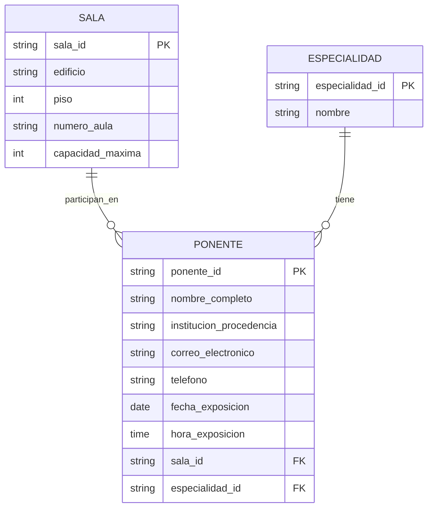
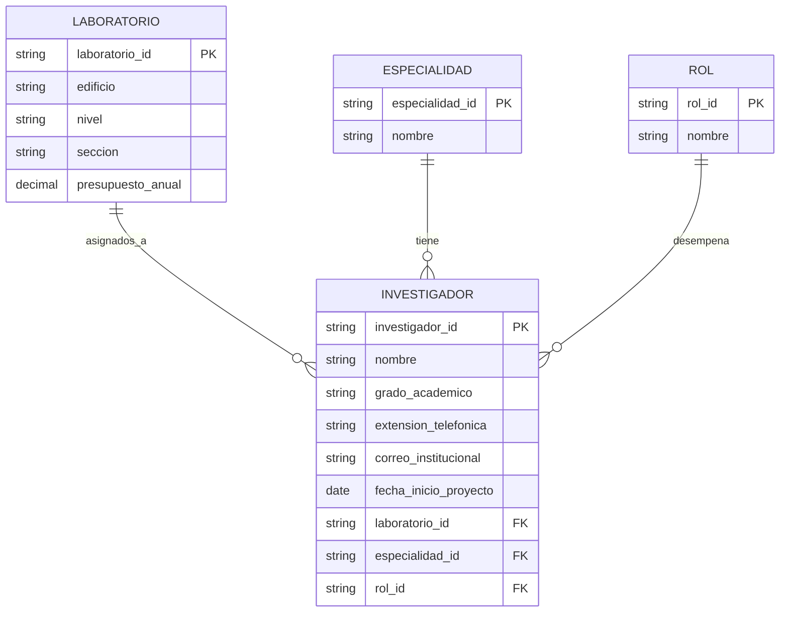

---
{"dg-publish":true,"permalink":"/uaslp/2026-b/59-bases-de-datos/59-2-segundo-parcial/59-2-4-ejercicios-diagrama-relacional-24-09/","dgHomeLink":true,"dgShowBacklinks":true,"dgShowLocalGraph":true,"dgShowGraphDepthControl":true,"dgShowInlineTitle":true,"dgShowFileTree":true,"dgEnableSearch":true,"dgShowToc":true,"dgLinkPreview":true,"dgShowTags":true,"dg-note-properties":{}}
---

Escenario 1: Congreso Internacional de Ingenieria
Una universidad organiza un congreso internacional y requiere registrar informacion para su sistema de gestion
- De cada ponente se almacena: su numero de identificaion, nombre completo, institucion de precedencia y especialidad (inteligentia arficial y aprendizaje auomatico, ciberseguridad y proteccion de datos, ingenieria de software y arquitectura de istemas, robotica y automatizacion industrial). Se registran tambien los datos de contacto de cada ponente (compuestos por correo electronico y telefono)
- Cada ponente participa en una sala, la cual tiene un codigo identificador, ubicacion (compuesta por edificio, piso y numero de aula) y capacidad maxima.
- En una sala pueden participar varios ponentes durante el evento, pero cada ponente tiene asignada unicamente una sala para su conferencia
- Ademas, cada participacion debe registrar la fecha y la hora de exposicion

Un centro de Investigacion y Proyectos Tecngologicos
Un centro de investifacion necesita orgainzar la informacion de los proyectos que desarrolla.
- De cada investigador se almacena: su numerode identificacion personal, nombre, grados acadmexico y area de especialidad (IA, robotica y mecatronica, ingeniria de software, internet de la cosas y ciencia de datos)
- Cada investigador esta asignado a un laboratorio, el cual tiene un codigo , ubicacion (compuesta por edificio, nivel y seccion) y presupuesto anual asignado
- Se registran tambien los datos de contacto dle investigador (compuestos por extension telefonica y correo institucional)
- un laboratorio puede tener varios investigadores asignados, pero cada investigador peretenece unicamente a un laboratorio
- Ademas, por cada signacion debe registrarse la fecha de inicio del proyecto y el rol que desempena el investigador dentro del laboratorio (investigador principal, co-investigador, responsable tecnico, disenador eperimental, coordinador de proyecto, becario de investigacion, asistente de laboratorio)

