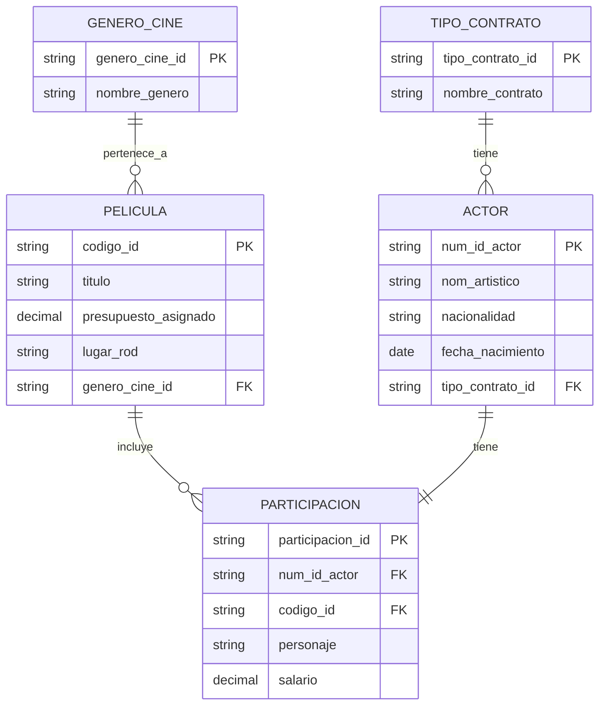

---
{"dg-publish":true,"permalink":"/uaslp/2026-b/59-bases-de-datos/59-2-segundo-parcial/59-2-5-ejercicios-diagrama-relacional-25-09/","dgHomeLink":true,"dgShowBacklinks":true,"dgShowLocalGraph":true,"dgShowGraphDepthControl":true,"dgShowInlineTitle":true,"dgShowFileTree":true,"dgEnableSearch":true,"dgShowToc":true,"dgLinkPreview":true,"dgShowTags":true,"dg-note-properties":{}}
---

Escenario 1: Sistema de Gestion de Produccion Cinematografica

Una productora cinematografica necesita registrar informacion para organizar el rodaje de sus peliculas.
- De cada actor se almacena:
	- num_id_actor
	- nom_artistico
	- nacionalidad
	- fecha_nacimiento
	- tipo_contrato_id
- De cada tipo contrato
	- tipo contrato id
	- nombre_contrato
- Cada actor participa en una **pelicula**, la cual tiene:
	- codigo_id
	- titulo
	- presupuesto_asignado
	- genero_cine_id
	- lugar_rod
- De cada genero cine:
	- genero_cine_id
	- nombre_genero
- una pelicula puede contar con varios actores pero cada actor parcicip aunicamente en una pelucla curante el periodo de produccion registrado
- Ademas, por cada participacion se debe registrar el personaje interpretado y el salario acordado

Escenario 2: Sistema de Gestion de Taleres de Capacitacion Empresarial

Una empresa organiza talleres internos de capacitacion y requiere estrcturar la informaicon.
- De cada empleado se registra: numero de empleado, nombre completo, puesto, telefonos de contacto
- Cada empleado se inscribe en un taller, el cual tiene un codigo, nombre del curso, duracion en  horas, modalidad (presencial, en linea, hibrido, intensivo) y el nivel de dificultad (basico, intermedio, avanzado, especializado, certficiacion)
- Cada taller se imparte en una sala, que tiene un identificador, ubicacion (compuesta por edificio, piso y numero) y capacidad maxima
- Una sala puede utilizarse para varios talleres en fechas distintas, pero cada taller se imparte en una sola sala
- Ademas, por cada inscripcion debe registrarse la fecha de inscripcion y la calificacion obtenida por el empleado

