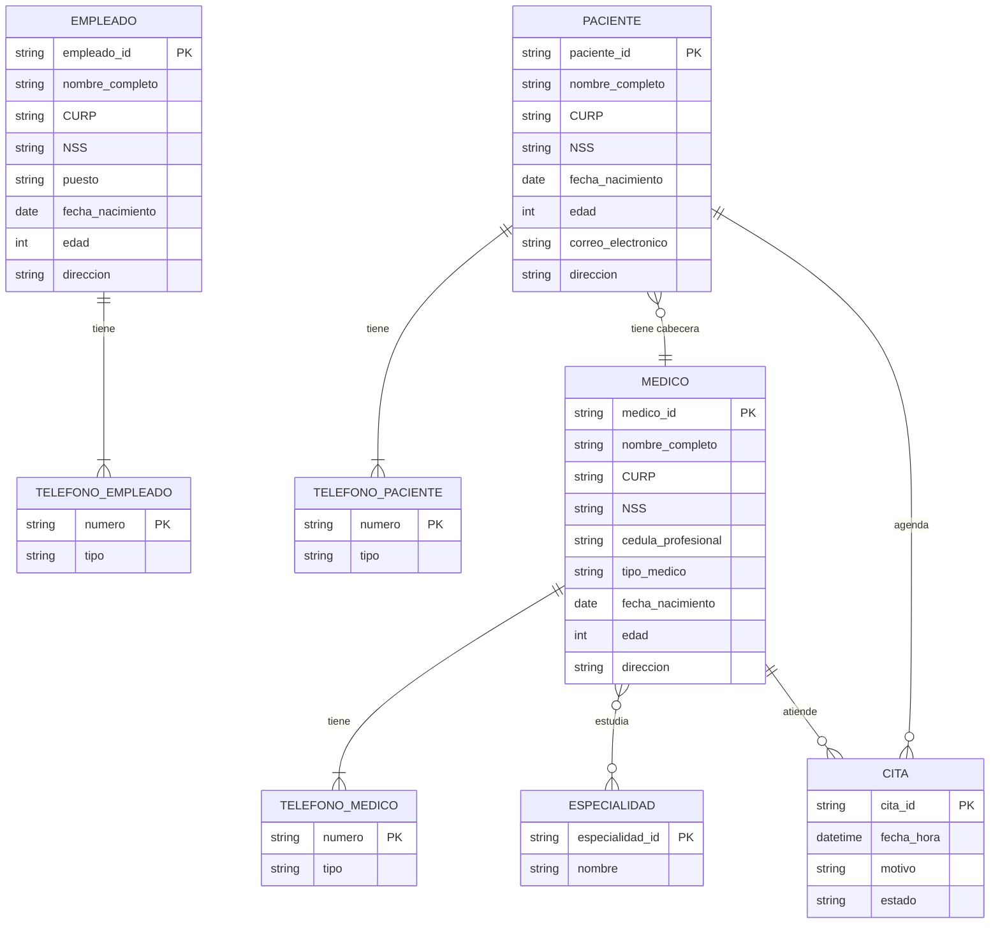

---
{"dg-publish":true,"permalink":"/uaslp/2026-b/59-bases-de-datos/actividades/actividad-5/","dgHomeLink":true,"dgShowBacklinks":true,"dgShowLocalGraph":true,"dgShowGraphDepthControl":true,"dgShowInlineTitle":true,"dgShowFileTree":true,"dgEnableSearch":true,"dgShowToc":true,"dgLinkPreview":true,"dgShowTags":true,"dg-note-properties":{}}
---

